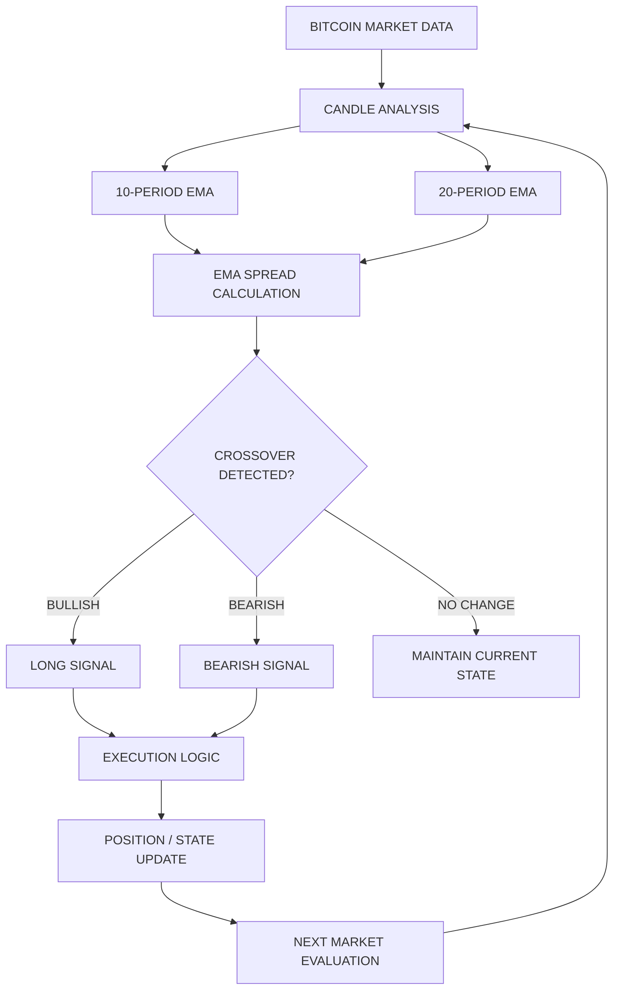

 

# ₿ QUANT-BTC-DEMAC-ENGINE

### THE BITCOIN DIRECTIONAL ALLOCATION ENGINE

**A systematic algorithmic trading engine built around a 10/20 EMA crossover and directional reversal strategy.**

**SIGNAL. EXECUTION. DISCIPLINE.**

---

## ◈ 01 — THE PROJECT

Financial markets move fast. Trading decisions need structure.

**Quant-BTC-DEMAC-Engine** is an algorithmic Bitcoin trading system designed to identify directional market transitions using a dual Exponential Moving Average (EMA) strategy.

The engine uses the relationship between the 10-period and 20-period EMAs to detect changes in market direction and translate them into systematic trading signals.

Instead of relying on subjective chart interpretation, the system follows a defined mathematical framework to identify bullish and bearish transitions.

The objective is simple:

> Transform market momentum into systematic, rule-based trading decisions.

---

## ◈ 02 — THE STRATEGY: 10/20 DEMAC

At the core of the engine lies a dual-EMA crossover mechanism.

| Indicator | Configuration | Purpose |
|---|---:|---|
| Fast EMA | 10 | Captures short-term momentum |
| Slow EMA | 20 | Establishes directional trend |
| EMA Spread | EMA 10 − EMA 20 | Identifies crossover transitions |
| Market | BTC trading instrument | Target market |
| Primary timeframe | Daily (1D) | Strategy specification |

### The mathematics

The system calculates:

\[
Spread_t = EMA_{10}(t) - EMA_{20}(t)
\]

**Bullish transition**

When the EMA spread moves from zero or below to above zero:

`Previous Spread <= 0 AND Current Spread > 0`

→ Bullish signal.

**Bearish transition**

When the EMA spread moves from zero or above to below zero:

`Previous Spread >= 0 AND Current Spread < 0`

→ Bearish signal.

The resulting crossover determines the intended directional transition.

---

## ◈ 03 — SYSTEM ARCHITECTURE

### Operational pipeline

1. **Market Data Acquisition** — Read the relevant BTC market candles.
2. **Indicator Computation** — Calculate the fast and slow EMAs.
3. **Signal Generation** — Evaluate the EMA spread for crossover events.
4. **Directional Classification** — Identify bullish or bearish transitions.
5. **Execution** — Apply the configured trading logic.
6. **Continuous Evaluation** — Repeat the process as new market data becomes available.

---

## ◈ 04 — BACKTESTING & PERFORMANCE

### THE NUMBERS THAT MATTER.

A trading strategy should be evaluated through measurable performance, not assumptions.

This section is reserved for verified results generated through the MetaTrader 5 Strategy Tester.

| PERFORMANCE METRIC | BACKTEST RESULT |
|:---:|:---:|
| **NET PROFIT** | `ADD ACTUAL RESULT` |
| **TOTAL RETURN** | `ADD ACTUAL %` |
| **PROFIT FACTOR** | `ADD ACTUAL VALUE` |
| **WIN RATE** | `ADD ACTUAL %` |
| **MAX DRAWDOWN** | `ADD ACTUAL %` |
| **TOTAL TRADES** | `ADD ACTUAL COUNT` |

### Backtest configuration

| Parameter | Tested configuration |
|---|---|
| Trading instrument | `ADD EXACT BROKER SYMBOL` |
| Timeframe | `ADD TESTED TIMEFRAME` |
| Testing period | `ADD START – END DATE` |
| Initial capital | `ADD DEPOSIT` |
| Spread / commission | `ADD TEST SETTINGS` |
| Modelling method | `ADD TEST MODE` |

### Performance evidence

The repository can include:

- MT5 Strategy Tester overview.
- Balance and equity curve.
- Individual trade history.
- Drawdown analysis.
- Backtest configuration and testing period.

**A note on performance:** Historical backtests are simulations, not guarantees of future results. Performance figures should be reproducible from the published EA version and documented testing conditions.

---

## ◈ 05 — TECHNOLOGY STACK

| Technology | Role |
|---|---|
| **MQL5** | Trading algorithm implementation |
| **MetaTrader 5** | Trading and testing environment |
| **MetaEditor** | Source development and compilation |
| **EMA** | Technical indicator methodology |
| **Git & GitHub** | Version control and project documentation |

---

## ◈ 06 — INSTALLATION & EXECUTION

### Requirements

- MetaTrader 5 desktop terminal.
- MetaEditor.
- Broker account with the required Bitcoin trading instrument.
- MQL5 Expert Advisor source file.

### Setup

**Step 1:** Open MetaTrader 5.

**Step 2:** Navigate to:

`File → Open Data Folder`

**Step 3:** Open:

`MQL5 → Experts`

**Step 4:** Place the Expert Advisor `.mq5` source file inside the folder.

**Step 5:** Open MetaEditor and compile the source using `F7`.

**Step 6:** Return to MetaTrader 5 and refresh the Expert Advisors section in Navigator.

**Step 7:** Attach the EA to the appropriate BTC chart and configure the required settings.

**Step 8:** Run historical simulations through the MT5 Strategy Tester before considering live deployment.

---

## ◈ 07 — RISK & LIMITATIONS

Algorithmic execution does not eliminate market risk.

The system may experience:

- False crossovers during sideways markets.
- Whipsaw signals during periods of high volatility.
- Slippage and spread-related execution differences.
- Performance variation across market conditions.
- Differences between historical simulations and live execution.

Position sizing, stop-loss behaviour, execution error handling and account-mode compatibility should be validated against the actual implementation before live deployment.

---

## ◈ 08 — DEVELOPMENT ROADMAP

- [ ] Core 10/20 EMA crossover strategy.
- [ ] Verify directional reversal execution.
- [ ] Document reproducible historical backtests.
- [ ] Configurable position sizing.
- [ ] Volatility-based filtering.
- [ ] Stop-loss and take-profit experimentation.
- [ ] Multi-timeframe analysis.
- [ ] Out-of-sample validation.
- [ ] Advanced performance analytics.
- [ ] Execution monitoring and diagnostics.

---

## ◈ 09 — PROJECT PHILOSOPHY

The idea behind Quant-BTC-DEMAC-Engine is not to predict every market movement.

It is to create a structured system that:

- Identifies directional transitions.
- Converts mathematical signals into trading logic.
- Reduces discretionary decision-making.
- Enables repeatable historical testing.
- Provides a foundation for systematic strategy development.

**The focus is on process, measurable performance and disciplined execution.**

---

## ◈ 10 — DISCLAIMER

This project is intended for educational, research and software-development purposes only.

It does not constitute financial or investment advice. Cryptocurrency trading involves significant risk and may result in substantial financial losses. Backtested performance does not guarantee future results.

Always test the system thoroughly in a demo environment before considering live trading.

---

# ₿ QUANT-BTC-DEMAC-ENGINE

### CODE THE STRATEGY. TEST THE HYPOTHESIS. MEASURE THE PERFORMANCE.

**Built for systematic Bitcoin trading research.**

